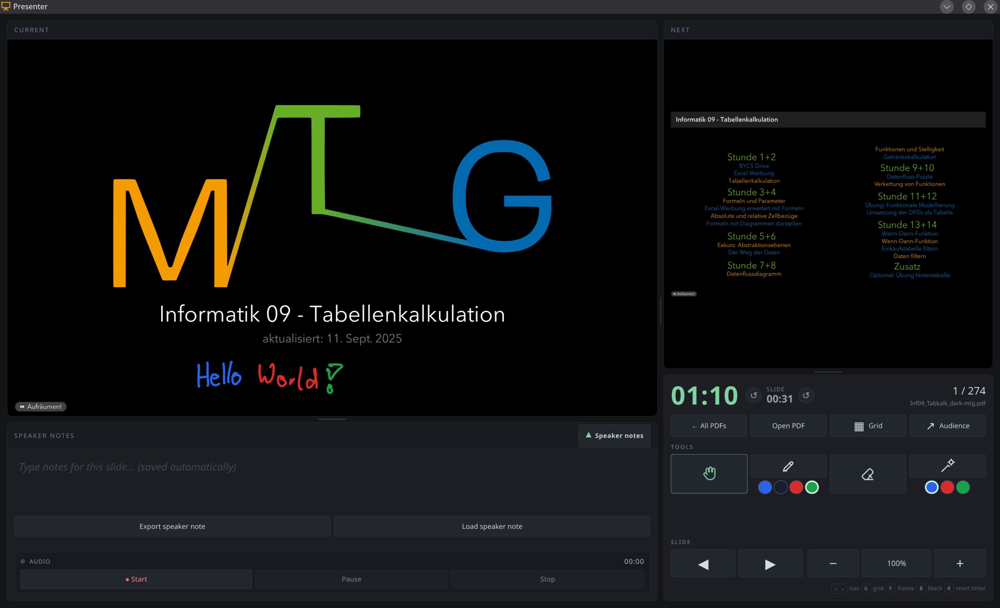

# PDF Presenter Network

<p align="center">
  <a href="https://github.com/ValentinHerrmann/pdf-presenter-network/actions/workflows/ci.yml"></a>
  <a href="https://github.com/ValentinHerrmann/pdf-presenter-network/releases/latest"></a>
  <a href="./LICENSE"></a>
</p>

> Serve PDF slides in the browser with a full presenter mode, and let audience devices and projectors on the local network follow along — speaker notes, next-slide preview, timers, annotations, and a laser pointer. Point it at a PDF and go.

<p align="center">
  
</p>

## About this fork

This is a fork of [htlin222/pdf-presenter](https://github.com/htlin222/pdf-presenter), adapted for presenting from one laptop to a room — classroom projectors, smart boards, or students' devices on the same LAN. Differences from upstream:

- **Network sync.** Presenter and audiences sync through a WebSocket on the server instead of only between windows of one browser, so any device on the LAN can open the audience view. Sync also works on restricted networks.
- **Always-on directory server.** Without a file argument the root URL is an audience view with a waiting screen; the presenter picks a PDF from `/list` or uploads one from anywhere with **Open PDF**.
- **Annotations.** Pen (with colours), eraser, and laser pointer, replicated live to every audience.
- **Zoom and pan** of the current slide, synced to audiences, plus clickable links inside the PDF.
- **Timed slides.** Beamer `\transduration{seconds}` pages advance automatically.
- **Per-slide timer** next to the overall timer in the presenter view.
- **Linux desktop app.** A systemd service on port 80 (`http://<hostname>/`) and a Chrome/Chromium app launcher.
- **Distributed via GitHub releases**, not npm. `npx pdf-presenter` installs the upstream package without these changes.

## Install

Requires Linux with systemd, Node.js ≥ 18, and Chrome or Chromium for the app window.

```bash
curl -fsSL https://github.com/ValentinHerrmann/pdf-presenter-network/releases/latest/download/install.sh | sh
```

This downloads the latest release to `~/.local/share/pdf-presenter-network/app`, installs the service and the **PDF Presenter Network** app-menu entry, and links the CLI to `~/.local/bin/pdf-presenter`. `sudo` is asked for once, to install the service.

- **Initial directory** for `/list` (default: your home directory): `curl -fsSL …/install.sh | sh -s -- /path/to/pdfs`
- **Specific version:** `curl -fsSL …/install.sh | PDF_PRESENTER_VERSION=v1.2.3 sh`
- **Hostname** shown in URLs (default: short hostname): `PDF_PRESENTER_HOST=vh`
- **Upgrade:** run the same command again.
- **Uninstall:**

  ```bash
  sudo systemctl disable --now pdf-presenter-network.service
  sudo rm /etc/systemd/system/pdf-presenter-network.service
  rm -rf ~/.local/share/pdf-presenter-network ~/.local/share/applications/pdf-presenter-network.desktop ~/.local/bin/pdf-presenter
  ```

### Without the service

Download `pdf-presenter-network.tar.gz` from the [latest release](https://github.com/ValentinHerrmann/pdf-presenter-network/releases/latest), unpack it, and run the CLI directly:

```bash
tar -xzf pdf-presenter-network.tar.gz
node pdf-presenter-network/dist/pdf-presenter.js slides.pdf
```

### From source

```bash
git clone https://github.com/ValentinHerrmann/pdf-presenter-network.git
cd pdf-presenter-network
pnpm install
sh scripts/install-linux.sh [/path/to/pdfs]   # builds, then installs like the release installer
```

### What the installer sets up

- The server runs as your user on HTTP port 80, so the audience view is at `http://<hostname>/` and the file browser at `http://<hostname>/list`. The service only receives the `CAP_NET_BIND_SERVICE` capability.
- **PDF Presenter Network** in the application menu opens `/list` in a separate Chrome/Chromium app window with an isolated browser profile.
- The directory is only the starting point for `/list`. **Open PDF** uploads a PDF from any location on the computer.
- The listing page has a web app manifest, so Chrome or Chromium can also install it from the browser's install icon.

### Releasing

Bump `version` in `package.json` and push to `main`. The [Release workflow](.github/workflows/release.yml) tags `vX.Y.Z`, builds `pdf-presenter-network.tar.gz` (bundle, UI, and production `node_modules`), and attaches it with `install.sh` to the GitHub release. Run the workflow manually from the Actions tab to rebuild the assets of the current version.

## Quick start

```bash
pdf-presenter slides.pdf           # serve & open browser
pdf-presenter -gn slides.pdf       # generate a notes template
pdf-presenter slides.pdf -t 20     # 20-minute countdown
pdf-presenter ./slides/            # browse a directory of PDFs
pdf-presenter                      # open the audience view for the current directory
```

## Why

Presenting a PDF deck usually means either:

- Opening the PDF in a viewer and losing speaker notes / next-slide preview, or
- Converting slides to HTML (and fighting layout, fonts, and build tooling).

`pdf-presenter` takes a third path: keep the PDF as-is, render it with `pdf.js` in the browser, and layer a presenter window (current + next + notes + timer) on top. Slide state syncs through the local server over WebSockets, so audience devices on the same LAN can follow the presenter. Start it without an argument to open the audience view for the current directory; use `/list` to browse and open a PDF.

## Features

- **Zero config.** One argument: the PDF file.
- **Dual views.** Audience view (fullscreen slide) and presenter view (current, next, notes, timer, counter).
- **Speaker notes** from a simple JSON file. Generate a template from the PDF text with `-gn`, or **edit notes directly in the presenter view** — changes are saved back to `slides.notes.json` automatically (debounced).
- **Timer.** Count up by default, or count down with `--timer <minutes>`. Colour shifts yellow in the last 5 min, red in the last 1 min.
- **Keyboard-first.** Arrow keys, `Space`, `PageUp/Down`, `Home/End`, plus `F` freeze, `B` black, `R` reset timer.
- **LAN synchronization** via WebSockets — the presenter window drives audience windows on the same computer or other devices on the local network.
- **Annotations.** Draw persistent per-slide pen strokes, erase complete strokes, or show a hover laser pointer. Annotations scale with the rendered slide and are replicated live to every audience.
- **Timed slides.** Beamer PDFs using `\transduration{seconds}` automatically advance from the presenter. The resulting slide changes are synchronized to every audience.
- **No native deps.** Pure JavaScript. `pdf.js` does the heavy lifting.

## Present to another device on your LAN

The server listens on all network interfaces. Start the presentation on the host computer, then open the audience URL from another device using the host's LAN address:

```text
http://192.168.1.42:3000/
```

Use the printed `localhost` URL for the presenter window on the host. The audience device must be on the same network, and the host firewall must allow inbound TCP connections on the selected port. Audience navigation is presenter-authoritative.

The presenter toolbar provides **Pen**, **Eraser**, and **Laser** tools. Pen strokes are stored in memory per slide for the current session; switching slides clears the visible overlay and restores that slide's strokes when revisited.

For Beamer decks, a page containing `\transduration{5}` advances after five seconds. Pages without a positive duration remain manual, and freeze/blackout pauses automatic advancement.

## Usage

### Serve a PDF or browse files

```bash
pdf-presenter [file-or-directory] [options]
```

When no file or directory is supplied, the current directory is served. The root URL is the audience view; before a presenter opens a PDF it shows a waiting screen. Use `/list` to browse and open a PDF.

| Flag | Alias | Default | Description |
|------|-------|---------|-------------|
| `--port <n>` | `-p` | `3000` (auto-increments if taken) | Server port |
| `--no-open` | | | Don't auto-open the browser |
| `--presenter` | | `false` | Open directly in presenter mode |
| `--notes <path>` | `-n` | `<file>.notes.json` | Path to notes JSON |
| `--timer <minutes>` | `-t` | none | Countdown timer in minutes |
| `--version` | `-v` | | Print version |
| `--help` | `-h` | | Print help |

On start you'll see:

```
🎯 pdf-presenter v1.0.0

   Audience:   http://localhost:3000
   Presenter:  http://localhost:3000/presenter

   PDF:   slides.pdf
   Notes: slides.notes.json (18/24 slides have notes)
   Timer: 20:00

   Press Ctrl+C to stop.
```

Share the **audience** URL (or window) with your viewers. Keep the **presenter** URL for yourself.

### Generate a notes template

```bash
pdf-presenter -gn slides.pdf
pdf-presenter --generate-presenter-note-template slides.pdf
pdf-presenter -gn slides.pdf --force    # overwrite existing
```

This reads the PDF, extracts the first line of text from each page as a `hint`, and writes `slides.notes.json` next to the PDF:

```json
{
  "meta": {
    "pdf": "slides.pdf",
    "totalSlides": 24,
    "generatedAt": "2026-04-10T12:00:00.000Z",
    "generator": "pdf-presenter"
  },
  "notes": {
    "1": { "hint": "Introduction — Welcome", "note": "" },
    "2": { "hint": "Agenda — Topics for Today", "note": "" }
  }
}
```

- `hint` is auto-extracted and shown in the presenter view when a slide has no `note`.
- `note` is what you write. It appears as the speaker notes in the presenter view.
- Keys are 1-indexed slide numbers.

If `slides.notes.json` already exists, `-gn` aborts with a warning — use `--force` to overwrite.

### Editing notes live

The presenter view doubles as an editor: click into the notes panel and type. Changes are saved back to `slides.notes.json` automatically (debounced ~600 ms after you stop typing). A small status indicator shows `Saving…` / `Saved` / `Save failed` next to the panel title.

- While the notes textarea is focused, keyboard shortcuts (arrow keys, `F`, `B`, `R`) are disabled so typing isn't hijacked. Press **`Esc`** to blur the editor and return to slide navigation.
- If `slides.notes.json` doesn't exist yet, the first save creates it.
- Existing `hint` fields are preserved. The panel title shows the hint for the current slide in a muted style.
- Writes are serialized server-side, so edits from multiple windows can't clobber each other mid-write.

## Keyboard shortcuts

Both views:

| Key | Action |
|-----|--------|
| `→` / `Space` / `PageDown` | Next slide |
| `←` / `PageUp` | Previous slide |
| `Home` / `End` | First / last slide (presenter) |

Audience view only:

| Key | Action |
|-----|--------|
| `P` | Open presenter view in a new window |

Presenter view only:

| Key | Action |
|-----|--------|
| `F` | Freeze / unfreeze the audience view |
| `B` | Black out the audience view |
| `R` | Reset the timer |

## Typical workflow

```bash
# 1. Generate the notes template
pdf-presenter -gn slides.pdf

# 2. Edit slides.notes.json in your editor, fill in "note" fields

# 3. Present
pdf-presenter slides.pdf --timer 20
```

Then:

1. The audience URL opens in your browser — share that window (or drag it to your projector / second display).
2. Open the presenter URL in a second window on your laptop screen.
3. Drive the deck from the presenter window. The audience window follows automatically.

## How it works

- `pdfjs-dist` (Mozilla `pdf.js`) renders each page to a `<canvas>` in the browser, scaled to fit the viewport at device-pixel-ratio resolution.
- The Node CLI ships a minimal `http` server (no Express, no middleware) that serves:
  - `/` → audience HTML
  - `/presenter` → presenter HTML
  - `/slides.pdf` → your PDF, streamed from disk
  - `/notes.json` → the notes file (or an empty stub if missing)
  - `/assets/*` → UI JS/CSS
  - `/assets/pdfjs/*` → the `pdfjs-dist` library and worker
- The presenter and audience connect to a WebSocket attached to the HTTP server. The presenter is authoritative for slide, freeze, blackout, cursor, and annotation events; the server keeps an in-memory snapshot for newly connected audiences.
- Overlay canvases sit above the PDF.js canvas. Coordinates are normalized to the rendered slide, so strokes and the laser pointer remain aligned across different device resolutions.
- Notes text extraction for `-gn` uses the legacy `pdfjs-dist` build, which runs in Node without a DOM or canvas.

## Development

```bash
make install    # pnpm install
make build      # tsup build → dist/
make check      # tsc --noEmit
make run        # build + run against test/fixtures/sample.pdf
make clean      # remove dist/ and node_modules/
```

Project layout:

```
pdf-presenter/
├── bin/pdf-presenter.ts       # CLI entry point
├── src/
│   ├── cli.ts                 # commander setup, command dispatch
│   ├── server.ts              # HTTP server + route map
│   ├── generate-notes.ts      # -gn command
│   ├── utils.ts               # path/port helpers
│   └── ui/                    # static frontend
│       ├── audience.html
│       ├── presenter.html
│       ├── presenter.css
│       └── presenter.js       # pdf.js rendering + WebSocket sync + overlays
└── test/fixtures/             # sample PDF for smoke tests
```

## License

MIT
